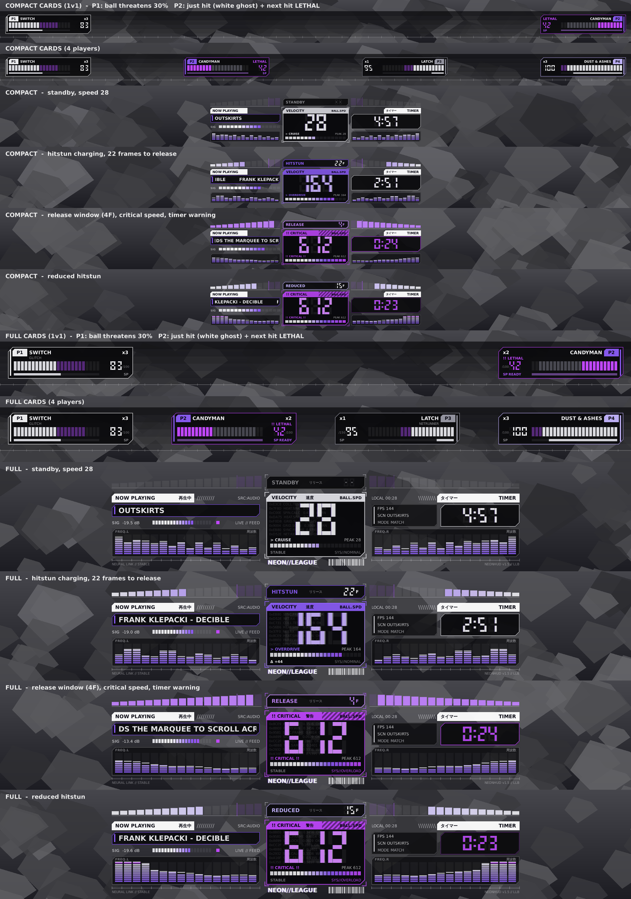

# NeonHUD

Cyberpunk HUD replacement for Lethal League Blaze (BepInEx 5).

Replaces the game's bottom speed/timer/track cluster and the player panels with neon seven-segment readouts, a frame-exact hitstun release meter and player cards. Values are read from the same places the game's own HUD reads them, so it works without any setup.



## Features

- Ball speed in seven-segment digits, colour shifts by speed tier, glitch on hit, peak speed and per-hit delta
- Release meter: frames until the ball leaves hitstun, release window highlight, RELEASE! flash, purple for reduced hitstun
- Player cards: HP with a threat overlay (what the ball would take off you right now), LETHAL warning, damage ghost, SP bar, stocks/points
- Timer, blinks under 30s on countdowns
- Now playing with a live audio spectrum
- Compact (default) and Full layouts, Mono / Neon / Custom themes
- Hides the vanilla HUD while it's showing (F8 to bring it back), hides itself while paused

Client-side and visual only, nothing changes for other players.

## Install

Grab it from Thunderstore, or build it yourself (below). Needs BepInExPack_LLBlaze.

## Controls

| Key | |
|-----|--|
| F7  | show/hide the HUD |
| F8  | show/hide the game's own HUD |
| F10 | demo mode (fake data, works anywhere) |
| F9  | write `BepInEx/NeonHUD_dump.txt` |
| F6  | reload the config |

All rebindable in the config.

## Config

Everything lives in `BepInEx/config/NeonHUD.cfg`. Edit it and hit F6 in game, no restart needed.

Main ones:

- `[General] Layout` - `Compact` or `Full`
- `[General] Scale`, `[PlayerCards] Scale` - sizes
- `[General] HideVanillaHud`, `HideWhenPaused`
- `[Theme] Preset` - `Mono`, `Neon` or `Custom` (Custom uses the hex values in `[Theme]` and `[PlayerCards] Team*`, `#RRGGBB` or `#RRGGBBAA`)
- `[Effects]` - every effect has its own toggle
- `[Data]` - where each value comes from (see below)

Only bool/int/string/key settings would show up in ModMenu's list, so for now it's the cfg file or the mod manager's config editor.

## Data sources

Each `[Data]` source is `Type::member.path`, with `|` for fallbacks. First one that gives a usable value wins. Defaults:

| | Source |
|---|---|
| speed | `LLScreen.ScreenGameHud.shownSpeedTarget` |
| timer | `World.GetTimeLeftSecs()`, falls back to time since the stage loaded |
| song | the vanilla track label, then the current music name |
| release | `ScreenGameHud.hitStunEntity` hitstun timer / duration |

Paths can use fields, properties, private members, `[i]` and method calls with literal args. Press F9 during a match to get a dump of candidates (`ui:`, `reflect:`, `find:`, `track:` lines) you can paste in.

Other plugins can push values instead. `feed` is first in every default chain:

```csharp
static Action<float> _neonSpeed;

static void FeedNeonHud(float speed)
{
    if (_neonSpeed == null)
    {
        foreach (var asm in AppDomain.CurrentDomain.GetAssemblies())
        {
            var m = asm.GetType("NeonHud.NeonHudFeed")?.GetMethod("SetBallSpeed");
            if (m != null) { _neonSpeed = (Action<float>)Delegate.CreateDelegate(typeof(Action<float>), m); break; }
        }
        if (_neonSpeed == null) return;
    }
    _neonSpeed(speed);
}
```

Also `SetTimer(seconds)`, `SetSong(title)`, `SetRelease(progress, framesLeft, reduced)` and `SetNoRelease()`.

## Building

Needs the .NET SDK.

```
dotnet build -c Release
```

It looks for the game in the usual Steam folders and for BepInEx in the Thunderstore Mod Manager `Default` profile, then copies the dll into that profile's `BepInEx/plugins/NeonHUD/`. Override with `-p:GameDir="..."`, `-p:TmmProfile=Name` or `-p:BepInExDir="..."`.

A Release build also writes `dist/NeonHUD-<version>.zip` for Thunderstore. The version has to match in `NeonHUD.csproj`, `src/Unity/Plugin.cs` and `thunderstore/manifest.json` or the build fails.

Tests run on a mocked Unity/BepInEx with Mono:

```
sh tests/run.sh
```

`tools/Preview` renders the HUD to a PNG without the game (`dotnet run -- preview.png`), since `src/Core` has no Unity dependency.

## Known issues

- Katakana labels need a font with those glyphs, set `JapaneseAccents = false` if you get boxes
- If the spectrum stays flat, turn `Spectrum` off
- IMGUI draws over the game's menus, that's why it hides while paused instead of sitting under the pause menu
